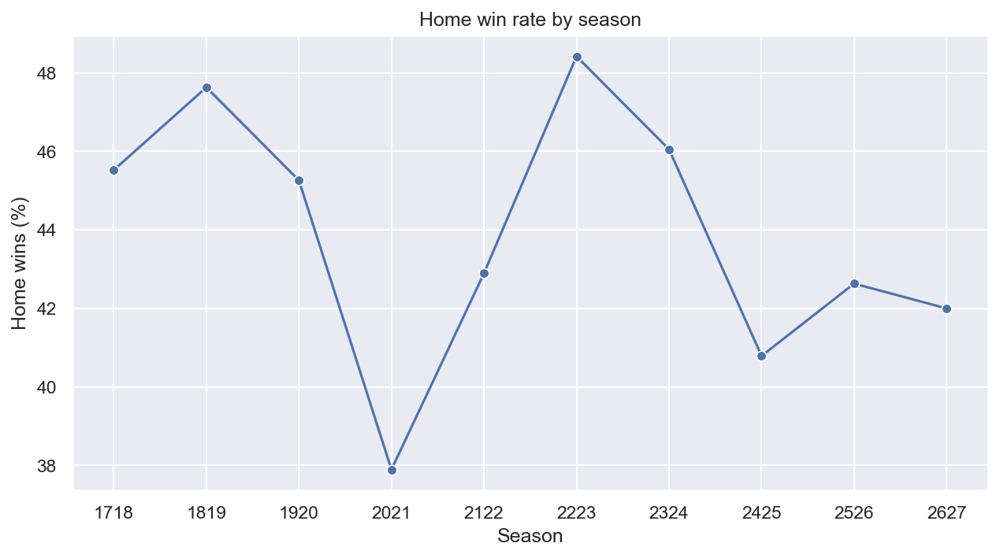

# Premier League Match Prediction

Predict how many goals each team will score in a Premier League match, turn those expectations into scoreline and win/draw/loss probabilities, and benchmark the result against bookmaker odds.

**Status:** modeling and validation are done (2024/25 validation season). Still to do: the final evaluation on the untouched 2025/26 test season, an optional LightGBM model, and a Streamlit demo.

## Results so far

Evaluated on the 2024/25 season (375 matches), with models trained on the seasons up to 2023/24:

| Model | Accuracy | Log loss |
|---|---|---|
| Constant (training result shares) | 41.1% | 1.078 |
| Baseline goals to Poisson | 41.1% | 1.078 |
| **Poisson regression** | **49.6%** | **1.019** |
| Bookmaker odds (Bet365, margin removed) | 54.1% | 0.971 |

- The model clearly beats the baselines and closes about 55% of the log-loss gap between the baseline and the bookmakers, using only recent-form features.
- It does not beat the bookmakers, whose odds reflect information the model lacks (lineups, injuries, overall team strength).
- Goal-level errors on the same season: MAE 0.993 (home) and 0.888 (away) against 1.050 and 0.929 for the baseline; Poisson deviance 1.172 and 1.071 against 1.239 and 1.142.
- With 375 matches, an accuracy figure carries about 2.6 points of sampling noise, so log loss is the steadier comparison.
- The model's most likely exact score is 1-1 in 305 of 375 matches. Its 12.3% exact-score hit rate therefore says little, and the probabilities are the real output.




## How it works

1. **Clean** nine seasons of results, plus the start of 2026/27, from football-data.co.uk.
2. **Build features** with SQL window functions: for each team before each match, its points over the last 5 matches, its average goals scored and conceded over the last 5 and 10, and its days of rest. Every window stops at the previous match, so nothing from the match itself leaks in.
3. **Model** expected goals with two Poisson regressions, one for home goals and one for away goals.
4. **Scorelines:** assuming independent Poisson goals, the two expected-goals numbers become a probability for every score from 0-0 to 10-10. Adding up those cells gives home win, draw and away win probabilities.
5. **Evaluate by time:** train on 2017/18 to 2023/24, compare models on 2024/25, and keep 2025/26 as a test season that is touched once.

## Notebooks

Run them in order.

| Notebook | What it does |
|---|---|
| `01_data_cleaning.ipynb` | Combines the season CSVs, parses dates, checks quality, saves `matches.csv` |
| `02_eda.ipynb` | Five questions about the data (results, home advantage, goals, home records, shots) and the "always home win" baseline |
| `03_sql.ipynb` | DuckDB: one row per team per match, a league table check against the real 2025/26 standings, and rolling-form features |
| `04_training_table.ipynb` | One row per match with home and away features, filtered and split by time |
| `05_models.ipynb` | Baseline and Poisson regression for expected goals |
| `06_scorelines_and_evaluation.ipynb` | Scoreline grid, win/draw/loss probabilities, comparison with the bookmakers, and `check_match` to test any past match |

## Data

- Source: [football-data.co.uk](https://www.football-data.co.uk/englandm.php) (please check the site's terms of use and credit it)
- Premier League from 2017/18 to 8 Nov 2026: nine full seasons (380 matches each) plus 100 matches of 2026/27, which is in progress
- Columns kept: results, shots, fouls, corners, cards and Bet365 odds
- The raw files are not stored in this repository. The cleaned files in `data/processed/` are, so notebooks 02 to 06 run without downloading anything.

## Validation approach

- **Time-based split, never random:** train up to 2023/24, validate on 2024/25, test on 2025/26. The 91 matches played so far in 2026/27 are held out for a later live demo.
- **No data leakage:** features use only matches played before kickoff. Shots, fouls, cards and odds from the match itself are never features.
- **Thin history is filtered out:** 119 of 3,520 matches (the first five rounds of 2017/18 and each newly promoted club's first five matches) are dropped because a team has fewer than 5 earlier matches.
- **Metrics:** log loss and accuracy for results; MAE and Poisson deviance for goals.
- **Benchmarks:** a constant baseline, a goals-only baseline, and the bookmakers' implied probabilities. The odds are used for evaluation only.

## Reproduce

```bash
git clone https://github.com/YOUR-USERNAME/football-prediction
cd football-prediction
uv sync
uv run jupyter lab
```

To rebuild everything from scratch, download the Premier League CSVs from football-data.co.uk into `data/raw/`, name them like `E1718.csv`, and start at notebook 01. Otherwise start at notebook 02.

## Project structure

```
football-prediction/
├── data/
│   ├── raw/                    # downloaded CSVs (not tracked)
│   └── processed/
│       ├── matches.csv         # cleaned matches (notebook 01)
│       ├── team_form.csv       # rolling-form features (notebook 03)
│       └── model_table.csv     # one row per match, ready for modeling (notebook 04)
├── notebooks/
│   ├── 01_data_cleaning.ipynb
│   ├── 02_eda.ipynb
│   ├── 03_sql.ipynb
│   ├── 04_training_table.ipynb
│   ├── 05_models.ipynb
│   └── 06_scorelines_and_evaluation.ipynb
├── reports/figures/            # charts used in the README
├── src/football_prediction/    # placeholder for reusable code
├── pyproject.toml
├── uv.lock
└── README.md
```

## Technologies

Python 3.9+, pandas, NumPy, SciPy, scikit-learn, DuckDB (SQL), matplotlib, seaborn, Jupyter, uv, Git/GitHub. Planned: LightGBM and Streamlit.

## Limitations

- **One validation season:** 375 matches, so differences of a few points are noisy. The test season has not been used yet.
- **Recent form only:** no team-strength rating, lineups, injuries or schedule context. This is the main reason the model trails the bookmakers.
- **Independence assumption:** home and away goals are modeled as independent, which slightly misjudges low scores and draws.
- **Season shift:** 2024/25 had fewer home wins (41.1%) than the training seasons (44.8%), so the model over-predicts home wins by about 3 points that season.
- **Exact scores:** the model almost always names 1-1 as the single most likely score, so exact-score accuracy is not meaningful.
- **Excluded matches:** 119 matches with thin history are not used, mostly involving newly promoted clubs.

## Future improvements

- Add a team-strength feature such as an Elo rating
- Try LightGBM with a Poisson objective
- Try a Dixon-Coles correction for low scores
- Run the final evaluation on the 2025/26 test season, then refit on all completed seasons
- Build a Streamlit demo: pick two teams, see expected goals, a scoreline grid and win/draw/loss probabilities
- Add expected goals (xG) data and more leagues

## About me

Hi, I'm Oussama, a Computer Science graduate (Bac +2) learning data science and AI. I'm building real-world projects in Python, SQL and machine learning to prepare for university studies and a career in data.

- Languages and tools: Python, SQL, Git
- Interests: sports analytics, machine learning, building things end to end
- Currently learning: feature engineering, model evaluation, deployment
