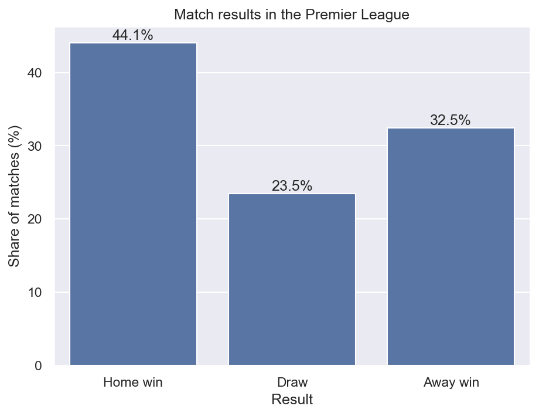

# Premier League Match Prediction

Predict how many goals each team will score in a Premier League match, turn those expectations into scoreline and win/draw/loss probabilities, and benchmark the result against bookmaker odds.

**Status:** end to end. Data cleaning, exploration, SQL features, modeling, scoreline evaluation, the final test-season evaluation, saved models and a Streamlit prototype are all done. An Elo team-strength feature and a LightGBM experiment remain optional next steps.

## Results

Two evaluations, with models trained **only** on seasons up to 2023/24 in both cases. Log loss is the steadier metric: with 375 matches, accuracy carries about 2.6 points of sampling noise.

**Validation season — 2024/25** (used to choose the model):

| Model | Accuracy | Log loss |
|---|---|---|
| Constant (training result shares) | 41.1% | 1.078 |
| Baseline goals to Poisson | 41.1% | 1.078 |
| **Poisson regression** | **49.6%** | **1.019** |
| Bookmaker odds (Bet365, margin removed) | 54.1% | 0.971 |

**Test season — 2025/26** (scored once, in notebook 07, after the model was chosen):

| Model | Accuracy | Log loss |
|---|---|---|
| Constant (training result shares) | 42.4% | 1.086 |
| Baseline goals to Poisson | 42.4% | 1.081 |
| **Poisson regression** | **48.8%** | **1.046** |
| Bookmaker odds (Bet365, margin removed) | 49.3% | 1.016 |

- The model beats both baselines on both seasons. It closes about 55% of the log-loss gap to the bookmakers on validation and about 54% on the test season, using only recent-form features.
- On the test season it is just 0.5 accuracy points behind the bookmakers (within sampling noise), but the bookmakers still have the better log loss, so they remain the stronger probabilistic benchmark. Their odds reflect lineups, injuries and market information the model lacks.
- Goal-level errors, validation: MAE 0.993 (home) and 0.888 (away) against 1.050 and 0.929 for the baseline; Poisson deviance 1.172 and 1.071 against 1.239 and 1.142.
- Goal-level errors, test: MAE 0.975 and 0.845 against 0.998 and 0.883; Poisson deviance 1.095 and 1.075 against 1.122 and 1.117.
- The most likely exact score was right in 12.3% of validation matches and 10.4% of test matches. That is close to what always naming 1-1 would achieve, so exact-score accuracy is not a measure of skill; the probabilities are the real output.
- Calibration is reasonable but not perfect. Validation: predicted 44.2% / 23.6% / 32.2% for home win / draw / away win against actual 41.1% / 24.0% / 34.9%. Test: 43.6% / 24.3% / 32.1% against 42.4% / 27.2% / 30.4%. The direction of the small home/draw shifts differs between the two seasons, which is a reminder that one season is a small sample.




## How it works

1. **Clean** nine seasons of results, plus the start of 2026/27, from football-data.co.uk.
2. **Build features** with SQL window functions: for each team before each match, its points over the last 5 matches, its average goals scored and conceded over the last 5 and 10, and its days of rest. Every window stops at the previous match, so nothing from the match itself leaks in.
3. **Model** expected goals with two Poisson regressions, one for home goals and one for away goals.
4. **Scorelines:** assuming independent Poisson goals, the two expected-goals numbers become a probability for every score from 0-0 to 10-10. Adding up those cells gives home win, draw and away win probabilities.
5. **Evaluate by time:** train on 2017/18 to 2023/24, compare models on 2024/25, score the chosen model once on 2025/26, then refit on all completed seasons for the demo. The in-progress 2026/27 season is held out.

## Notebooks

Run them in order.

| Notebook | What it does |
|---|---|
| `01_data_cleaning.ipynb` | Combines the season CSVs, parses dates, checks quality, saves `matches.csv` |
| `02_eda.ipynb` | Five questions about the data (results, home advantage, goals, home records, shots) and the "always home win" baseline |
| `03_sql.ipynb` | DuckDB: one row per team per match, a league table check against the real 2025/26 standings, and rolling-form features |
| `04_training_table.ipynb` | One row per match with home and away features, filtered and split by time |
| `05_models.ipynb` | Baseline and Poisson regression for expected goals |
| `06_scorelines_and_evaluation.ipynb` | Scoreline grid, win/draw/loss probabilities, comparison with the bookmakers, exact-score hit rate, calibration and `check_match` |
| `07_final_evaluation.ipynb` | One test-season evaluation, refit on all completed seasons and joblib export |

## Data

- Source: [football-data.co.uk](https://www.football-data.co.uk/englandm.php) (please check the site's terms of use and credit it)
- Premier League from 2017/18 to 8 Nov 2026: nine full seasons (380 matches each) plus 100 matches of 2026/27, which is in progress
- Columns kept: results, shots, fouls, corners, cards and Bet365 odds
- The raw files are not stored in this repository. The cleaned files in `data/processed/` are, so notebooks 02 to 07 run without downloading anything.

## Validation approach

- **Time-based split, never random:** train up to 2023/24, validate on 2024/25, test on 2025/26. The test score in notebook 07 is recorded once; afterwards the models are refitted on all completed seasons, and the 91 matches played so far in 2026/27 are held out for a live demo.
- **No data leakage:** features use only matches played before kickoff. Shots, fouls, cards and odds from the match itself are never features.
- **Thin history is filtered out:** 119 of 3,520 matches (the first five rounds of 2017/18 and each newly promoted club's first five matches) are dropped because a team has fewer than 5 earlier matches.
- **Metrics:** log loss and accuracy for results; MAE and Poisson deviance for goals.
- **Benchmarks:** a constant baseline, a goals-only baseline, and the bookmakers' implied probabilities. The odds are used for evaluation only.
- **Fixed log-loss helper:** `result_metrics` in `src/football_prediction/metrics.py` computes the probability of the true result by hand. `sklearn.metrics.log_loss` sorts labels as A/D/H while our columns are H/D/A, so using it directly would silently swap home and away.

## Reproduce

```bash
git clone https://github.com/oelfatouaki/football-prediction
cd football-prediction
uv sync
uv run jupyter lab
```

To rebuild everything from scratch, download the Premier League CSVs from football-data.co.uk into `data/raw/`, name them like `E1718.csv`, and start at notebook 01. Otherwise start at notebook 02. Run notebook 07 before the app, since it creates the saved models.

```bash
uv run streamlit run streamlit_app.py
```

The app has two team dropdowns and a kick-off date. It shows expected goals, a scoreline grid, win/draw/loss chances and the five most likely scores, using each team's most recent form.

## Project structure

```
football-prediction/
├── data/
│   ├── raw/                    # downloaded CSVs (not tracked)
│   └── processed/
│       ├── matches.csv         # cleaned matches (notebook 01)
│       ├── team_form.csv       # rolling-form features (notebook 03)
│       └── model_table.csv     # one row per match, ready for modeling (notebook 04)
├── models/                     # poisson.joblib (not tracked, created by notebook 07)
├── notebooks/
│   ├── 01_data_cleaning.ipynb
│   ├── 02_eda.ipynb
│   ├── 03_sql.ipynb
│   ├── 04_training_table.ipynb
│   ├── 05_models.ipynb
│   ├── 06_scorelines_and_evaluation.ipynb
│   └── 07_final_evaluation.ipynb
├── src/football_prediction/
│   ├── data.py                 # loading and time-based splits
│   ├── metrics.py              # fixed log-loss helper and goal metrics
│   ├── models.py               # Poisson fit, predict, joblib save/load
│   ├── predict.py              # features and prediction for one fixture
│   └── scorelines.py           # scoreline grid and WDL probabilities
├── reports/figures/            # charts used in the README
├── streamlit_app.py            # interactive prototype
├── pyproject.toml
├── uv.lock
└── README.md
```

## Technologies

Python 3.9+, pandas, NumPy, SciPy, scikit-learn, DuckDB (SQL), matplotlib, seaborn, Jupyter, joblib, Streamlit, uv, Git/GitHub. Planned: LightGBM.

## Limitations

- **One validation season and one test season:** 375 matches each, so differences of a few points are noisy. The bookmakers' edge in log loss is small but consistent across both.
- **Recent form only:** no team-strength rating, lineups, injuries or schedule context. This is the main reason the model trails the bookmakers.
- **Independence assumption:** home and away goals are modeled as independent, which slightly misjudges low scores and draws. The test season's draw share was under-predicted by about 3 points.
- **Exact scores:** the model almost always names 1-1 as the single most likely score, so exact-score accuracy is not meaningful.
- **Excluded matches:** 119 matches with thin history are not used, mostly involving newly promoted clubs.
- **In-progress season:** 2026/27 is held out, so the app's default prediction uses the most recent completed form as of 8 Nov 2026.

## Future improvements

- Add a team-strength feature such as an Elo rating
- Try LightGBM with a Poisson objective
- Try a Dixon-Coles correction for low scores
- Add expected goals (xG) data and more leagues

## About me

Hi, I'm Oussama, a Computer Science graduate learning data science and AI. I'm building real-world projects in Python, SQL and machine learning to prepare for university studies and a career in data.

- Languages and tools: Python, SQL, Git
- Interests: sports analytics, machine learning, building things end to end
- Currently learning: feature engineering, model evaluation, deployment
